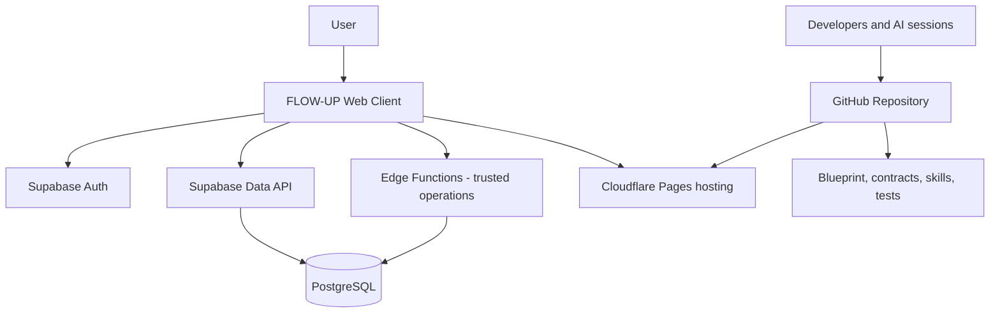

# Initial System Context

## Trust boundaries
- Browser/mobile clients are untrusted.
- RLS is mandatory for exposed user-owned data.
- Service role secrets exist only in trusted server-side environments.
- Static hosting serves client assets; it does not make server-side secrets safe.
- AI tools must not receive production secrets or personal user data unnecessarily.

## Open design decisions
- Direct Supabase client access vs API/Edge Function for each use case.
- Authentication method for contest demo.
- Whether guest/demo mode is required.
- Exact project/workspace relationship.
- Data deletion and retention behavior.
